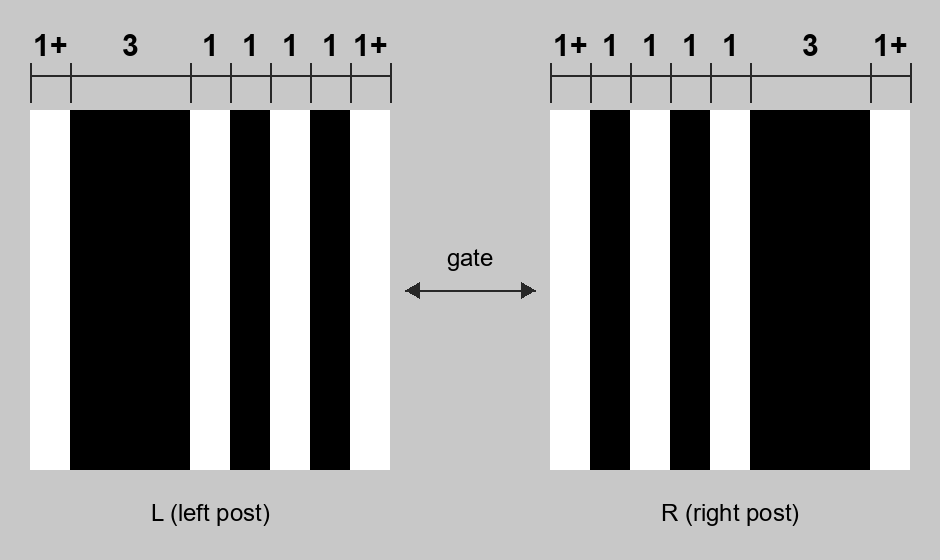

<div align="right"><a href="./README_jp.md">日本語はこちら</a></div>

# FpvGateMarker (FGM)

A striped marker for FPV drone race gates, and a detector (Python / OpenCV) that finds it in the onboard camera feed.

## Features

- One marker on each side post of a gate. For round gates, a ring of stripes goes all the way around.
- Easy to make: it is just black and white vertical stripes. No printer needed — black tape on a white board works.
- Lightweight: it only reads a few sparse horizontal lines (about 0.5–2 ms at 640×480, a fraction of ArUco).
- Robust to blur, noise and interlace combing in analog video.

The full specification (marker dimensions, detection steps, performance) is in [docs/spec.md](docs/spec.md).


## Markers

| | Horizontal pattern (left to right, in modules) |
| --- | --- |
| Left post | white ≥1 : black 3 : white 1 : black 1 : white 1 : black 1 : white ≥1 |
| Right post | white ≥1 : black 1 : white 1 : black 1 : white 1 : black 3 : white ≥1 |
| Round gate ring (outside → inside) | white 1 : black 3 : white 1 : black 1 : white 1 : black 1 : white 1 |



Mount the stripes vertically, with the thick black band on the outer side of the gate.
Taller markers are easier to read and still work when the drone is tilted.

### Making one with tape

Stick black vinyl tape vertically on a white board or sheet of paper. If one tape width is one module, the left post is
3 tapes of black, a 1-tape gap, 1 tape, a gap, 1 tape (the right post is the mirror image).
The detector reads ratios, so small errors are fine. Leave at least one module of white on the outer sides.

### Printing

Ready-to-print files are in [print/](print/) (no Python needed):

- [marker_fgm_left.png](print/marker_fgm_left.png) / [marker_fgm_right.png](print/marker_fgm_right.png): for the left
  and right posts (11 × 16 modules). Print at any size, keeping the aspect ratio.
- [marker_fgm_ring.pdf](print/marker_fgm_ring.pdf): ring for a round gate with a 600 mm inner diameter (15 mm modules,
  870 mm outer diameter), in 10 A4 arc segments. Print at 100% (actual size), cut along the gray lines and stick them
  around the gate. [marker_fgm_ring_preview.png](print/marker_fgm_ring_preview.png) shows the whole ring.

For other sizes (e.g. a different gate diameter), make them with Python:

```
pip install ".[opencv,pdf]"            # in this folder
fgm-make-markers                       # writes to markers/
fgm-make-markers --gate-inner 700 --gate-module 15   # ring for a 700 mm gate
```

## Detection

```python
from fgm import FgmDetector

det = FgmDetector()                 # one per video stream (camera)
d = det.detect(frame)               # BGR or grayscale image
d.visible                           # is the gate visible
d.corners, d.ids                    # corners of each FGM found, and "L" / "R" (for drawing)
```

`visible` turns True when both the left and right markers are seen, and stays True until both are gone
(it does not turn False when one side leaves the frame first as you approach the gate). For lap timing, count a pass when
`visible` goes from True to False (waiting about 100 ms helps ignore single missed frames).

| Argument | Default | Meaning |
| --- | --- | --- |
| `line_step` | 4 | Read every Nth pixel row |
| `min_lines` | 3 | Number of consecutive rows needed to accept a marker |
| `min_size_pct` | 5.0 | Minimum marker width (black part) as % of frame height. Ignores distant gates |
| `tol` | 0.25 | Tolerance of the stripe spacing, in modules. Smaller means fewer false positives (OSD characters etc.) but small markers become harder to read |

For small images such as 640×480, OpenCV runs faster with a single thread (`cv2.setNumThreads(1)`).
This is a process-wide setting, so the detector does not change it.

OpenCV is not a required dependency (installing both `opencv-python` and `opencv-contrib-python` breaks things).
If you do not have it, install with the `[opencv]` extra.

## Development

```
pip install -e ".[opencv,pdf]"
python tests/test_fgm.py                    # tests on synthetic video
python tools/bench.py --videos a.mp4        # comparison with ArUco (speed, detection rate, false positives)
```

### Lap timer for testing

Runs a camera (or video file) through the detector and times laps. A pass is counted when the gate goes from visible
to not visible for 100 ms; the pass time is the last frame the gate was visible. Each pass beeps (`--no-beep` to turn it off).

```
python tools/laptimer.py                    # find cameras, choose one if several; preview window (q quit, r reset laps)
python tools/laptimer.py --camera 1         # camera 1, e.g. an analog video capture device
python tools/laptimer.py --list-cameras     # list the cameras found
python tools/laptimer.py --camera a.mp4 --headless --log laps.csv   # a recording, laps to CSV
```

Passes within 2 s of the previous one are ignored (`--min-lap`; lower it for fast tracks).
The window shows the detected markers (L / R), whether the gate is visible, the current lap, detection time and
the last 10 laps (best in yellow). Press q / Esc to quit and print a summary, r to reset laps.
When several cameras are found, a window shows live video from each; press its number to choose.
Frames are resized to 640×480 before detection (`--size none` keeps the original). See `--help` for the other options.

## License

MIT
