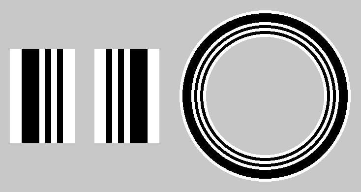

<div align="right"><a href="./README.md">English</a></div>

# FpvGateMarker（FGM）

FPV ドローンのゲートに貼る縦縞のマーカーと、機体のカメラの映像からそれを読む検出器（Python / OpenCV）。

- ゲートの左右の柱に1枚ずつ貼る。円形ゲートには、輪に沿って1周貼る。
- 黒白の縦縞だけなので作るのが簡単。印刷しなくても、白地に黒のテープを貼るだけで作れる。
- 横線を間引いて読むだけなので軽い（640×480 で約0.5〜2ms。ArUco の数分の1）。
- アナログ映像のボケ・ノイズ・インターレースのずれに強い。

仕様（マーカーの寸法・検出の手順・性能）は [docs/spec_jp.md](docs/spec_jp.md)。



## マーカー

| | 横方向の並び（左から、マス） |
| --- | --- |
| 左の柱 | 白1以上 : 黒3 : 白1 : 黒1 : 白1 : 黒1 : 白1以上 |
| 右の柱 | 白1以上 : 黒1 : 白1 : 黒1 : 白1 : 黒3 : 白1以上 |
| 円形ゲートの輪（外→内） | 白1 : 黒3 : 白1 : 黒1 : 白1 : 黒1 : 白1 |

太い黒がゲートの外側に来るように、縞を縦にして貼ります。縦に長いほど読みやすく、機体が傾いても読めます。

白い板や紙に黒のビニールテープを縦に貼るだけでも作れます。テープの幅を1マスにすると、左の柱なら
テープ3本ぶんの黒・1本ぶんの隙間・1本・隙間・1本です（読むのは比なので、多少ずれても読めます）。
外側にも1マス以上の白を残してください。

印刷用の画像を作る:

```
pip install ".[opencv,pdf]"            # このフォルダで
fgm-make-markers                       # markers/ に出力
fgm-make-markers --gate-inner 700      # 内径700mm の円形ゲート用
```

- `marker_fgm_left.png` / `marker_fgm_right.png`: 左右の柱用。
- `marker_fgm_ring.pdf`: 円形ゲート用（既定は内径600mm、A4 10枚）。**100%（実際のサイズ）で印刷**し、扇形に切って1周貼ります。
  外側と内側の白も切り落とさないでください。

## 検出

```python
from fgm import FgmDetector

det = FgmDetector()                 # 映像（カメラ）ごとに1つ作る
d = det.detect(frame)               # BGR かグレーの画像
d.visible                           # ゲートが見えているか
d.corners, d.ids                    # 見つかった FGM ごとの四隅と "L" / "R"（枠の表示用）
```

`visible` は、左右の両方が見えたら True になり、その後は左右の両方とも見えなくなるまで True のままです
（ゲートに近づいて片方が先に画面から出ても False にならない）。ラップを計るときは、`visible` が True → False になった時を通過にします
（一瞬読めなかったのを通過にしないよう、100ms ほど待つとよい）。

| 引数 | 既定 | 意味 |
| --- | --- | --- |
| `line_step` | 4 | 何画素おきの横線を読むか |
| `min_lines` | 3 | この本数の横線で続けて見つかったら1枚とする |
| `min_size_pct` | 5.0 | FGM の幅の最小（フレーム高さに対する %）。遠くのゲートを読まない |

640×480 くらいの小さい画像では、OpenCV のスレッドを1本にしたほうが速くなります（`cv2.setNumThreads(1)`。
アプリ全体の設定なので、検出器の中では変えていません）。

OpenCV は依存に入れていません（`opencv-python` と `opencv-contrib-python` を両方入れると壊れるので）。
入っていなければ `[opencv]` を付けて入れてください。

## 開発

```
pip install -e ".[opencv,pdf]"
python tests/test_fgm.py                    # 合成映像でのテスト
python tools/bench.py --videos a.mp4        # ArUco との比較（処理時間・認識率・誤検出）
```

使っているアプリ: d-plactice-ArUco（FPV ドローンのラップタイマー）

## ライセンス

MIT
